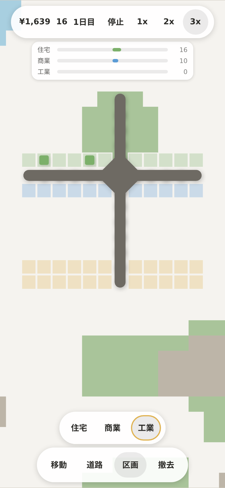
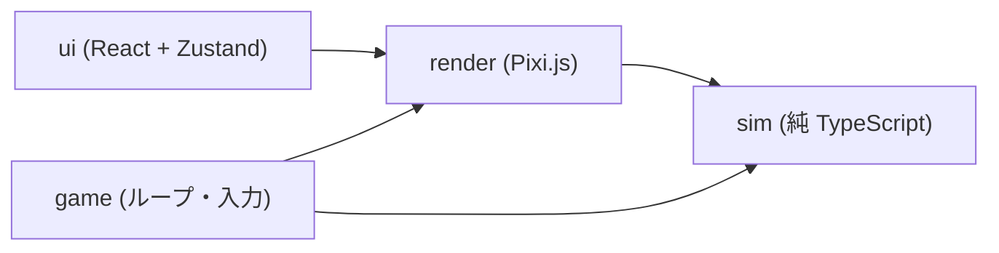

# MachiScape

道をつないで、まちを育てる。Mini Metro / Mini Motorways の系譜にあるミニマルなまちづくり Web ゲーム。



## 概要

プレイヤーが引くのは道路だけです。道沿いに区画（住宅・商業・工業）を塗ると建物が自動で建ち、住民の車と物流トラックが実際に道路を走ります。渋滞は数値ではなく、1 台ずつの車が詰まった結果として生まれ、詰まった街は育たなくなります。

**渋滞せず、人と物が流れる道路網を設計すること**がゲームの核です。ゲームオーバーはなく、時間はいつでも止められます。スマホのタッチ操作を前提に設計しています。

## 主な機能

- 道路ツール（ドラッグで直線を引き、指を離して確定）と区画ツール（住宅・商業・工業）
- 個別車両のシミュレーション（8 方向 A* の経路探索、混雑度に応じた迂回、交差点、車列、合流）
- 住民の通勤・通学と、工場から店への配送。到達できないと満足度が下がり退去する
- 需要・満足度・日次の収支といった経済、HUD、情報表示（Inspector、需要バー）
- 施設、マイルストーン、エリア購入、セーブ機能
- 決定論的なマップ生成（川を含む）
- 画像アセットを使わない、フラットな図形とソフトシャドウの見た目

## 技術スタック

| 層 | 技術 | 場所 |
|---|---|---|
| シミュレーション | 純 TypeScript（依存ゼロ・決定論） | `src/sim/` |
| 描画 | Pixi.js v8（WebGL） | `src/render/` |
| UI | React 19 + Zustand | `src/ui/` |
| ゲームループ・入力 | 純 TypeScript | `src/game/` |
| ビルド / テスト | Vite / Vitest / pnpm | |
| CI | GitHub Actions（lint, typecheck, test, build） | `.github/workflows/` |

## アーキテクチャ



**シミュレーションを描画から完全に分離しています。** `src/sim/` は `Math.random`・`Date`・DOM を使わず、シード付き乱数と固定タイムステップだけで動きます。同じシードと同じ操作なら必ず同じ結果になり、これをテストで担保しています。依存方向（`ui → render → sim`）と決定論は ESLint で機械的に強制しています。

この分離により、シミュレーションを単体で検証でき、描画方式を変えても中身が壊れず、セーブ/ロードも素直に実装できます。バランス数値は `src/sim/balance.ts` に一元化し、ユーザー向け文字列は `src/i18n/ja.ts` に集約しています。

## セットアップと起動

前提: Node.js 22 以上、pnpm。

```bash
pnpm install
pnpm dev        # 開発サーバ（--host 付き。同じ LAN のスマホからも開ける）
```

| 目的 | コマンド |
|---|---|
| テスト | `pnpm test` |
| 型チェック | `pnpm typecheck` |
| Lint | `pnpm lint` |
| 本番ビルド | `pnpm build` |
| 整形 | `pnpm format` |

TypeScript は 6.0.3 に固定しています（TS 7 は typescript-eslint が未対応で lint が起動しないため）。

## ディレクトリ構成

```
src/
  sim/       シミュレーション本体（mapgen, road, traffic, growth, economy, facility, progress, save）
  render/    Pixi.js 描画
  ui/        React UI（HUD, Toolbar, Inspector など）
  game/      ゲームループ・入力アクション
  i18n/      ユーザー向け文字列
docs/        計画書・実装書・設計判断・マイルストーン計画
proto/       空間モデル比較の試作（品質対象外）
CLAUDE.md    Claude Code 向けプロジェクト規約
```

## Claude Code での開発

このリポジトリは Claude Code と、計画 → 実装 → 検証の流れで作りました。

- **計画先行**: `docs/plan.md`（計画書）と `docs/implementation-spec.md`（実装書。全仕様の単一の正本）を先に書き、実装は実装書に従います。矛盾を見つけたら実装書を直してから実装する、という規約を `CLAUDE.md` に置きました。
- **比較試作で設計判断**: グリッド / 自由曲線 / ヘックスの 3 方式を `proto/` で試作して比べ、グリッドを採用しました。判断理由は `docs/decisions.md` に記録しています。
- **マイルストーン運営**: M3 以降はマイルストーンごとの計画書（`docs/m3-plan.md` 〜 `m6-plan.md`）を作ってから実装しました。プレイテストで「街が読めず面白さを判定できない」と分かった際は、判断記録に残したうえで計画の順序を入れ替えています。
- **機械的な検証**: Vitest のテストファイル 34 本（現時点で 398 件が通過）、決定論テスト、ベンチマーク（車両 1500 台規模の 1 tick 時間）、ESLint による依存方向の強制、CI（lint / typecheck / test / build）。
- **人が判断する領域**: 面白さの判定（プレイテスト）は人間が行う運用で、エージェントが自己完結させない規約にしています。

## ライセンス

未定
